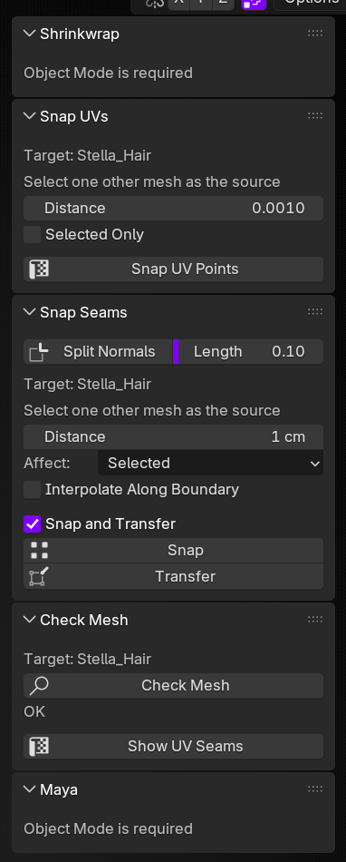

# Work Tools

Version 1.0.0. Blender tools for matching mesh seams and sending meshes to Maya. For Blender 4.5 or newer.

Versions use three numbers. A fix is 1.0.1, a new tool is 1.1.0, and a change that can break an existing scene is 2.0.0. The number in the addon is `bl_info["version"]`.

The active mesh is the target. The other selected mesh is the source.

- **Snap Seams** snaps selected vertices to the source, then copies normals onto them.
- **Snap UVs** snaps nearby UV points to the source. It does not replace the whole UV map.
- **Shrinkwrap** shrinkwraps the target onto the source and applies the modifier.
- **Check Mesh** finds unwelded vertices, extra UV channels, and n-gons.
- **Maya** sends the selected meshes to an open Maya scene, keeping custom normals and sharp edges. Check Mesh can stop the send when it finds a problem.

Install `work_tools.zip` from the repository root.
